# Отчет по учебному проекту: «Стримчик»

## 1. Введение

### 1.1. Контекст задачи

Интернет-магазин «Стримчик» продаёт компьютерные игры по всему миру. В распоряжении имеются исторические данные о продажах игр, оценки пользователей и экспертов, жанры и платформы. Задача — выявить закономерности, определяющие успешность игры, чтобы сделать ставку на потенциально популярный продукт и спланировать рекламные кампании на 2017 год.

Данные представлены до 2016 года (который может быть неполным). Несмотря на то что прогноз строится на 2017 год, отрабатывается сам принцип работы с данными: подход применим и к более поздним периодам.

### 1.2. Описание данных

Датасет содержит следующие поля:

- `Name` — название игры;
- `Platform` — платформа (например, Xbox или PlayStation);
- `Year_of_Release` — год выпуска;
- `Genre` — жанр игры;
- `NA_sales` — продажи в Северной Америке (млн копий);
- `EU_sales` — продажи в Европе (млн копий);
- `JP_sales` — продажи в Японии (млн копий);
- `Other_sales` — продажи в других странах (млн копий);
- `Critic_Score` — оценка критиков (максимум 100);
- `User_Score` — оценка пользователей (максимум 10);
- `Rating` — возрастной рейтинг ESRB (Entertainment Software Rating Board).

### 1.3. Этапы работы

Проект выполнен в несколько этапов:

1. Загрузка и предварительный осмотр данных.
2. Предобработка: приведение типов, обработка пропусков, создание агрегированных признаков.
3. Исследовательский анализ данных (EDA).
4. Составление портрета пользователя по регионам (NA, EU, JP, Other).
5. Проверка статистических гипотез.
6. Формулировка итоговых выводов и рекомендаций.

## 2. Загрузка и предобработка данных

После загрузки данных (`pd.read_csv('data/games.csv')`) выполнены:

- `year_of_release` приведён к `Int64`.
- `user_score`  значения `'tbd'` (to be decided) заменены на `NaN`, поле приведено к `float`.
-  Удалены строки без названия и жанра —  всего 2, потеря информации незначительна, а без названия/жанра игра не идентифицируется.
- Частично заполнены пропуски в  `year_of_release` — извлечен год из названия игры через регулярное выражение `(\d{4})` (например, «FIFA 12», «NBA 2K14»). Часть пропусков удалось восстановить.
- Удалены строки, где одновременно пропущены все ключевые для анализа поля(`year_of_release`, `critic_score`, `user_score`, `rating`) — такие записи не несут аналитической ценности (нельзя ни отнести к периоду, ни проанализировать оценки).
- Заполнены ппропуски в  `rating` — вместо `NaN` использовано значение `"RP - нет рейтинга"` (Rating Pending), так как отсутствие рейтинга — это самостоятельная категория, а не потеря данных. Для удобства чтения построен словарь `rating_map` с расшифровкой каждого рейтинга (E — для всех, M — 17+, T — 13+ и т.д.).
- Пропуски в `critic_score` и `user_score` оставлены как есть: их нельзя корректно восстановить, а при расчёте корреляций и t-тестов они автоматически исключаются (`dropna`).
- Добавлено поле `total_sales` — суммарные продажи по всем регионам.

## 3. Исследовательский анализ данных

### 3.1. Количество выпущенных игр по годам

**Цель:** понять, какие периоды релевантны для анализа и насколько полны данные.

Построен гистограммный график распределения числа игр по годам выпуска.

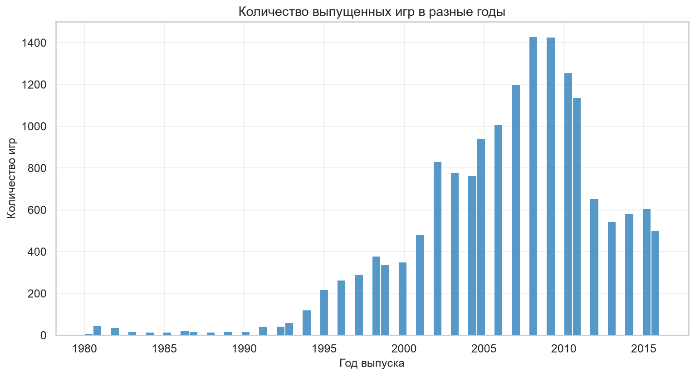

**Наблюдения:**
- До 1990 года выпускалось крайне мало игр — несколько десятков в год, что объясняется ранним этапом развития индустрии;
- с середины 1990-х начинается активный рост;
- пик выпуска приходится на 2005–2011 годы (более 1000 игр в год);
- после 2011 года наблюдается спад, а данные за 2016 год неполные.

**Вывод:** для анализа и построения прогноза на 2017 год данные до 1990 года неинформативны. Кроме того, для кампании на 2017 год логичнее использовать только актуальные данные (см. п. 3.3), поскольку рынок игр быстро меняется.

### 3.2. Продажи по платформам

**Цель:** выделить лидирующие платформы и сгруппировать их по масштабу.

Рассчитаны суммарные продажи каждой платформы (`groupby('platform').agg({'total_sales': 'sum'})`), построен отсортированный barplot.

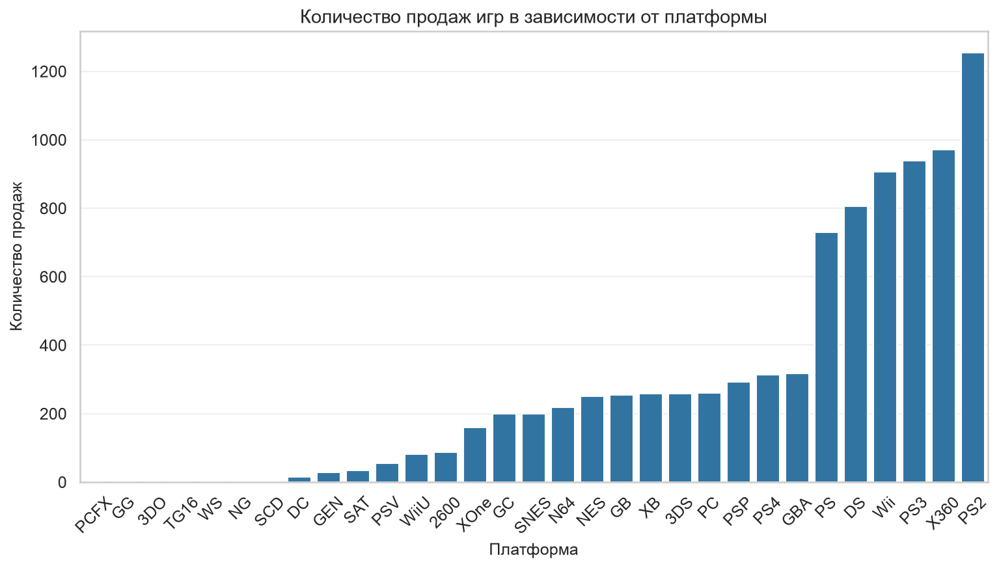

**Наблюдения:** платформы чётко распадаются на три группы:

| Группа | Суммарные продажи | Платформы |
|---|---|---|
| Лидеры | > 700 млн копий | PS2, X360, PS3, Wii, DS, PS |
| Средние | 200–400 млн копий | GBA, PSP, PS4 и др. |
| Остальные | < 200 млн копий | PC, XOne, 3DS, WiiU, PSV и др. |

**Вывод:** разброс огромен — от 20 млн до 1200 млн копий. Это говорит о том, что выбор платформы — ключевой фактор для успеха игры.

### 3.3. Динамика продаж по годам для топ-платформ

**Цель:** определить, какие платформы актуальны на 2017 год, а какие уходят с рынка.

Для 6 лидирующих платформ (DS, PS, PS2, PS3, Wii, X360) построен сгруппированный barplot продаж по годам, а затем — сетка из 16 отдельных графиков по каждой платформе датасета.

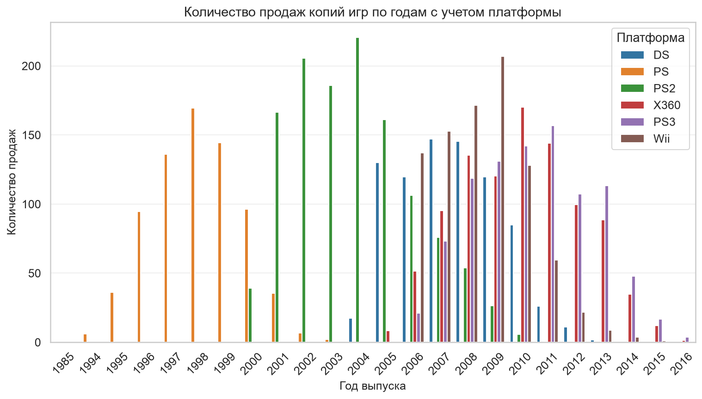

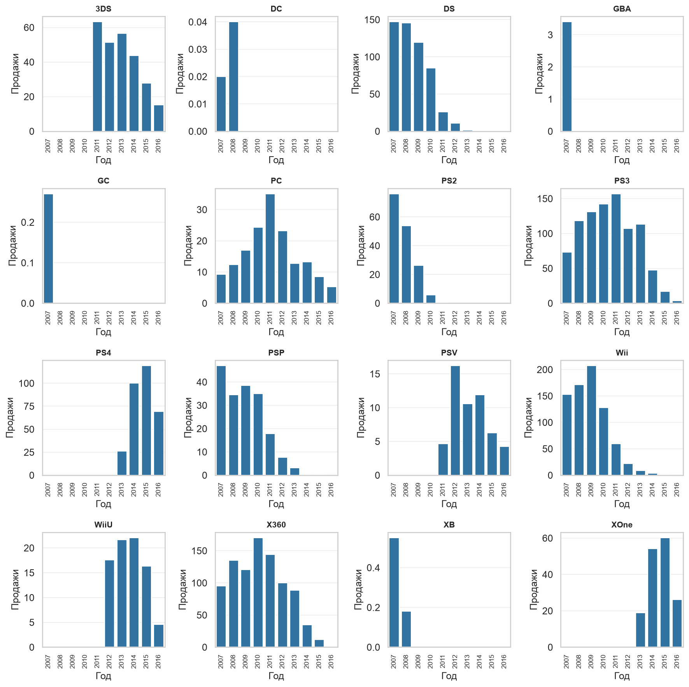

**Наблюдения:**

1. **Завершившие цикл платформы:** DC, DS, GBA, GC, PS2, XB — продаж в последние годы нет, цикл завершён.
2. **На завершающей стадии:** PS3, PSP, Wii, X360 — прошли пик и приближаются к концу 10-летнего цикла жизни.
3. **PC** — особый случай: пик в 2011 году, но продажи держатся стабильно, платформа не исчезает, поскольку не привязана к одному поколению консолей.
4. **3DS, PSV** — формально в начале жизненного цикла, но продажи ежегодно снижаются (3DS: 63 → 51 → 56 → 43 → 27 → 15; PSV: 4.6 → 16 → 10 → 11 → 6 → 4). Тренд негативный.
5. **PS4, WiiU, XOne** — в начале жизненного цикла: продажи стабильны или растут. PS4: 26 → 100 → 119 млн; XOne: 19 → 54 → 60 млн. Это самые перспективные платформы.

**Вывод о жизненном цикле платформ:** средний срок жизни платформы — **около 10 лет** (от запуска до прекращения выпуска игр). Для кампании на 2017 год имеет смысл использовать данные **не позднее 2007 года** — примерно за 10 лет до прогнозного периода. Ранние данные описывают уже «мёртвые» платформы и не помогут в прогнозе.

**На этом основании в дальнейшем анализе оставлены только игры 2007 года выпуска и новее** (с удалением платформ DC, DS, GBA, GC, PS2, XB как завершивших цикл).

### 3.4. Распределение продаж по платформам («ящик с усами»)

**Цель:** сравнить не только суммарные, но и типичные продажи игр на каждой платформе, а также выявить выбросы (хиты).

Построен boxplot по глобальным продажам в разбивке по платформам.

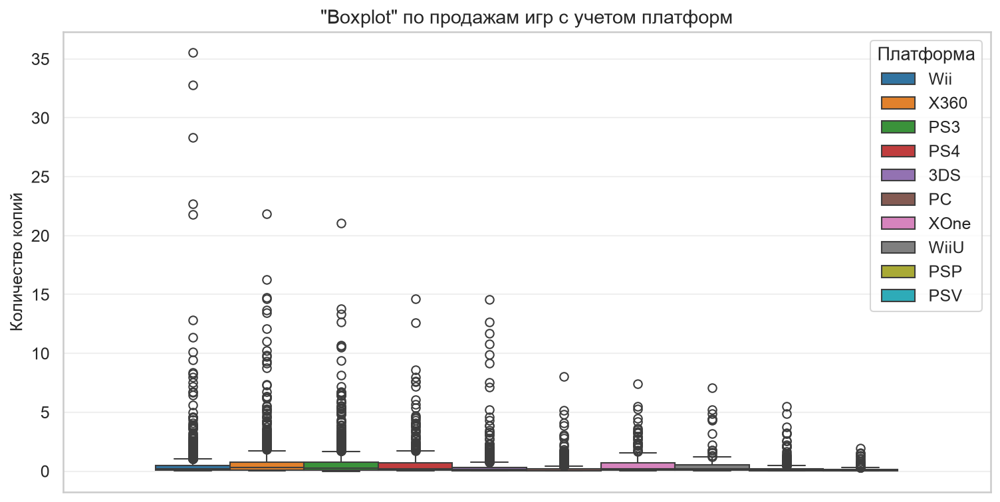

**Наблюдения:**
- Медианные продажи у большинства платформ близки (несколько сотен тысяч копий);
- «хвосты» распределений уходят далеко вверх — есть игры-хиты с продажами 20+ млн копий;
- у **Wii** — несколько таких хитов (самый длинный хвост выбросов);
- у X360 и PS3 — по одной игре-миллионнику в верхней части распределения.

**Вывод:** внутри каждой платформы распределение продаж имеет сильную правостороннюю асимметрию (типичная игра продаётся слабо, но редкие хиты обеспечивают основную часть выручки). Это типично для игровой индустрии и объясняет, почему средние продажи сильно выше медианных.

### 3.5. Влияние оценок критиков и пользователей на продажи (на примере Wii)

**Цель:** понять, какой тип отзывов сильнее связан с коммерческим успехом.

В качестве примера выбрана платформа Wii. Построены две диаграммы рассеяния: продажи vs оценка критиков и продажи vs оценка пользователей.

Первоначально продажи сильно «прижаты» к оси X (из-за огромного разброса — от 0.01 до 82 млн), поэтому для наглядности продажи прологарифмированы:

```python
wii_platform['log_total_sales'] = np.log(wii_platform.total_sales)
```

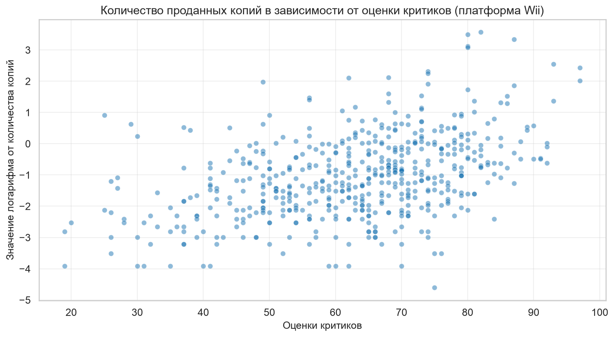

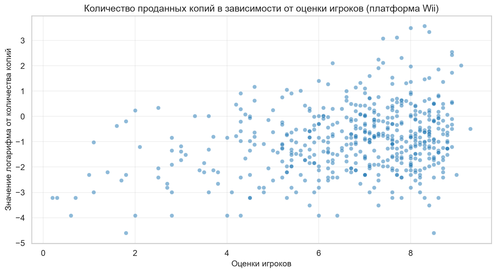

**Наблюдения:**
- На графике «продажи vs критики» виден явный восходящий тренд: игры с оценкой критиков ниже 60 почти не продаются, а при оценке 80+ появляется множество хитов;
- На графике «продажи vs пользователи» тренд выражен значительно слабее, точки «размазаны» по всему облаку.

**Корреляционный анализ (`pingouin.pairwise_corr`):**

| Пара | r (Pearson) | p-value | CI95 | Мощность |
|---|---|---|---|---|
| `total_sales` ↔ `critic_score` | **0.39** | < 0.001 | [0.31, 0.46] | 1 |
| `total_sales` ↔ `user_score` | **0.03** | 0.001 | [-0.06, 0.11] | 0.1 |

**Вывод:** обе корреляции статистически значимы, но связь с оценками критиков заметно сильнее и обладает высокой мощностью, а доверительный интервал оценок пользователей пересекает 0. Оценки критиков — более надёжный индикатор коммерческого успеха, чем оценки пользователей.

### 3.6. Влияние оценок на продажи для перспективных платформ (PS4, XOne, WiiU)

**Цель:** проверить, воспроизводится ли выявленная закономерность на актуальных платформах, которые важны для прогноза 2017 года.

Для наглядности продажи вновь прологарифмированы (с добавлением константы, чтобы избежать логарифма нуля):

```python
filter_data['log_total_sales'] = np.log(filter_data.total_sales + 10**(-10))
```

Построен scatterplot с разбивкой по платформе (hue='platform').

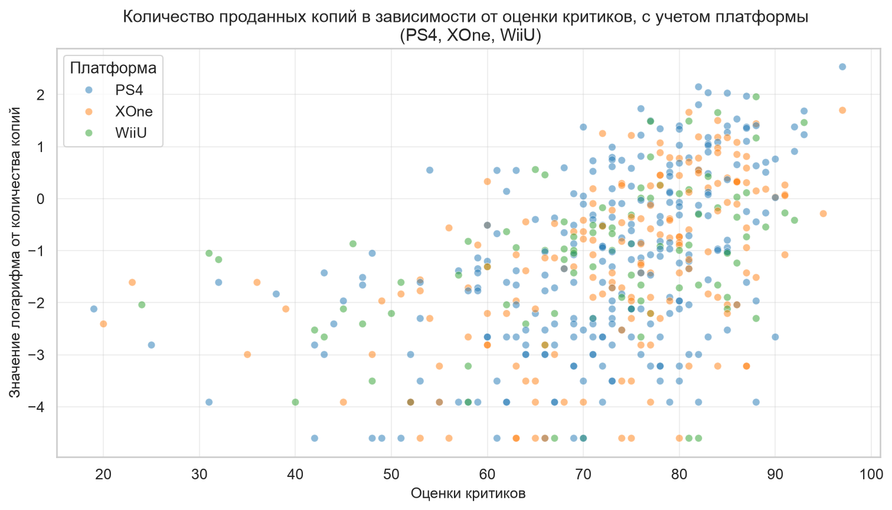

**Корреляционный анализ:**

| Пара | r (Pearson) | p-value |
|---|---|---|
| `total_sales` ↔ `critic_score` | **0.39** | < 0.001 |
| `total_sales` ↔ `user_score` | 0.03 | 0.50 |

**Вывод:**
- Для перспективных платформ связь продаж с оценками критиков **ещё сильнее** (r = 0.39);
- связь с оценками пользователей **практически отсутствует** (r = 0.03).

Это усиливает практический вывод: при отборе игр в каталог и при планировании рекламных кампаний следует опираться прежде всего на оценки профессиональных критиков.

### 3.7. Продажи по жанрам

**Цель:** определить самые прибыльные и самые «слабые» жанры.

Построены два barplot: средние продажи на игру (`estimator='mean'`) и общие продажи (`estimator='sum'`) в разрезе жанров.

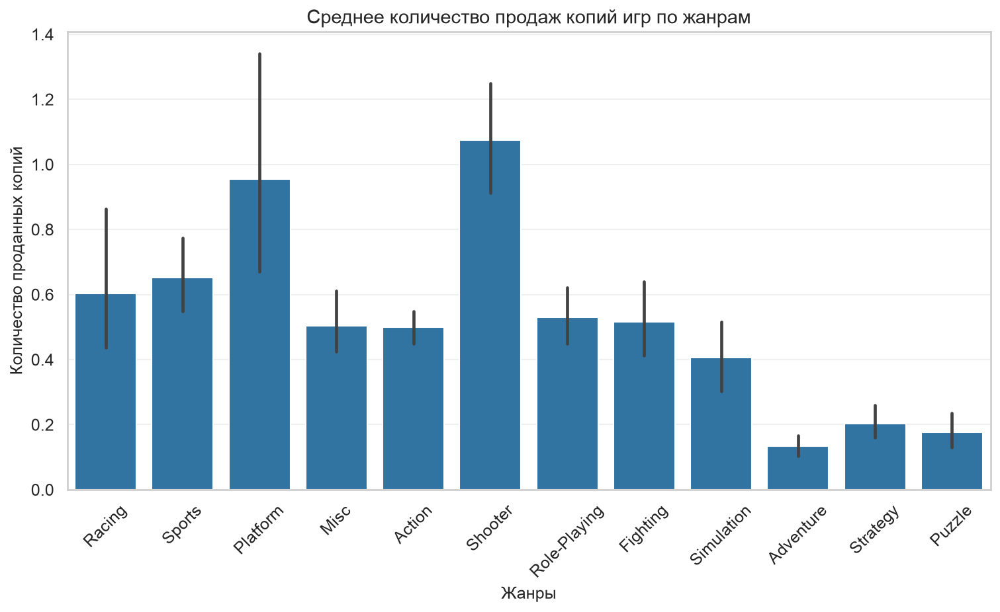

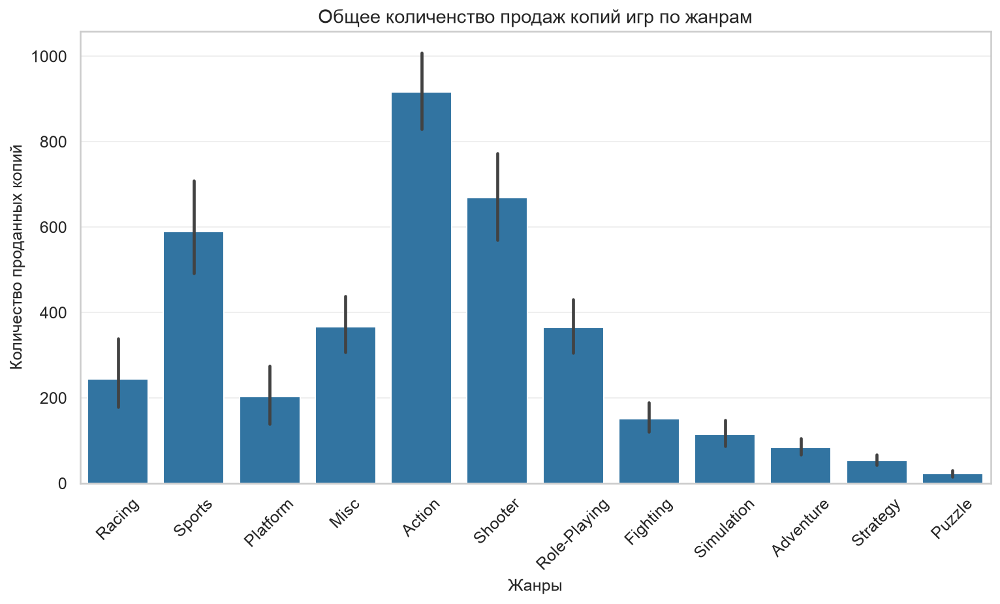

**Наблюдения:**

| Жанр | Среднее | Общее | Комментарий |
|---|---|---|---|
| **Shooter** | Высокое | Высокое | Лидер по обоим показателям |
| **Platform** | Высокое | Низкое | Мало игр, но каждая продаётся хорошо |
| **Sports** | Средне-высокое | Высокое | Стабильный массовый жанр |
| **Action** | Среднее | Высокое | Самый массовый жанр |
| **Role-Playing** | Среднее | Высокое | Особенно популярен в Японии |
| **Adventure, Strategy, Puzzle** | Низкое | Низкое | Аутсайдеры |

**Вывод:** Shooter — самый прибыльный жанр в расчёте на игру. Sports и Action образуют «массовый» сегмент: много игр и высокие суммарные продажи. Adventure, Strategy и Puzzle имеют низкие показатели по обоим параметрам, что делает их неприоритетными для ставки в рекламной кампании.

## 4. Портрет пользователя по регионам

**Цель:** понять, чем отличаются предпочтения игроков в Северной Америке (NA), Европе (EU), Японии (JP) и других регионах (Other), чтобы адаптировать рекламную стратегию под каждый рынок.

Для этого данные сгруппированы по платформам, жанрам и рейтингам ESRB с подсчётом суммарных продаж в каждом регионе. Таблицы приведены к «длинному» формату через `pd.wide_to_long` для удобной визуализации.

### 4.1. Популярные платформы

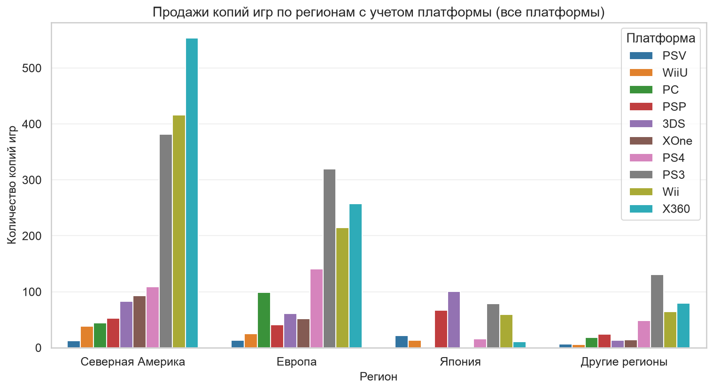

Для наглядности перспектив отдельно построен график только по трём актуальным платформам (PS4, WiiU, XOne).

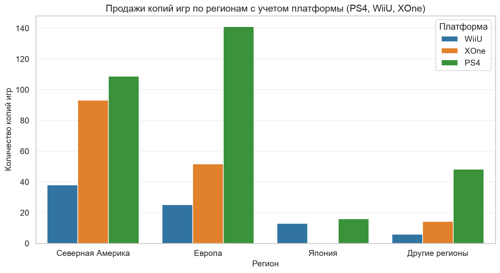

**Выводы по регионам:**

| Регион | Топ-5 платформ | Перспективные (для 2017) |
|---|---|---|
| **Северная Америка** | PS4, XOne, PS3, Wii, X360 | **PS4, XOne** |
| **Европа** | PC, PS4, Wii, X360, PS3 | **PS4** |
| **Япония** | PSP, PS3, Wii, 3DS | **WiiU, PS4** |
| **Другие регионы** | PS4, Wii, X360, PS3 | **PS4** |

**Ключевые наблюдения:**
- В Северной Америке наблюдается явное доминирование консолей Microsoft (X360, XOne) и Sony (PS4, PS3);
- В Европе выделяется **PC** — единственный регион, где эта платформа в топе;
- В Японии с большим отрывом лидируют портативные и локальные платформы (PSP, 3DS), а также PS3 и Wii — это принципиально иной рынок;
- PS4 лидирует во всех регионах, кроме Японии.

### 4.2. Популярные жанры

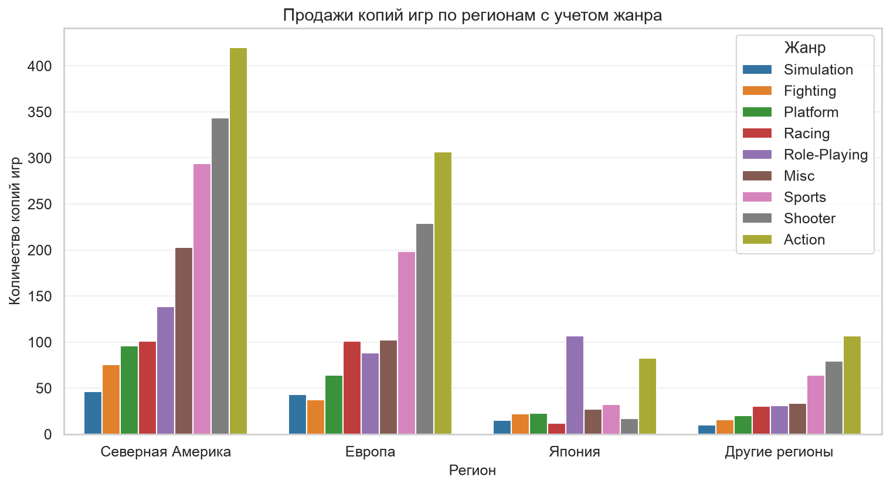

Из графика исключены непопулярные жанры (Adventure, Strategy, Puzzle) — они не создают шума и не искажают картину.

**Выводы по регионам:**

| Регион | Топ-жанры |
|---|---|
| **Северная Америка** | Action, Shooter, Sports|
| **Европа** | Action, Shooter, Sports|
| **Япония** | **Role-Playing, Action** (с огромным отрывом) |
| **Другие регионы** | Action, Shooter, Sports|

**Ключевые наблюдения:**
- В NA, EU и Other популярность жанров очень похожа — это фактически один «западный» рынок;
- **Япония радикально отличается:** здесь доминирует Role-Playing, а Shooter и Sports почти не продаются.

### 4.3. Влияние рейтинга ESRB на продажи

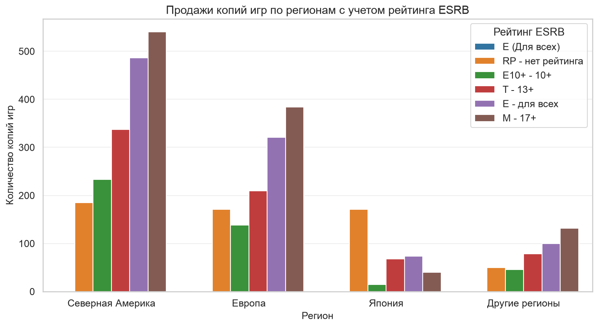

**Выводы по регионам:**

| Регион | Наиболее популярные рейтинги |
|---|---|
| **Северная Америка** | M (17+), E (для всех), T (13+) |
| **Европа** | M (17+), E (для всех), T (13+) |
| **Япония** | **RP (нет рейтинга)**, T (13+), E (для всех) |
| **Другие регионы** | M (17+), E (для всех), T (13+) |

**Ключевые наблюдения:**
- В NA, EU и Other рейтинг **ESRB** оказывает заметное влияние на продажи: игры с рейтингами M, E и T доминируют;
- В **Японии** большая часть продаж приходится на игры **без рейтинга ESRB** — вероятно,  это связано с законодательством.

## 5. Проверка статистических гипотез

Проверены две гипотезы на уровне значимости **α = 0.05**.

### 5.1. Гипотеза о равенстве средних пользовательских рейтингов Xbox One и PC

**Формулировка:**
- **H0:** средние пользовательские рейтинги платформ Xbox One и PC одинаковые;
- **H1:** средние пользовательские рейтинги платформ Xbox One и PC различаются.

**Метод:** t-тест Уэлча (не предполагает равенства дисперсий — корректно для групп с разным разбросом и размером).

Для теста взяты непустые значения `user_score` по каждой платформе (после предобработки и фильтрации с 2007 года).

**Результаты:**

| T | dof | p-value | CI95 | Cohen's d | Мощность |
|---|---|---|---|---|---|
| -2.047 | 333.9 | **0.041** | [-0.48, -0.01] | 0.17 | 0.49 |

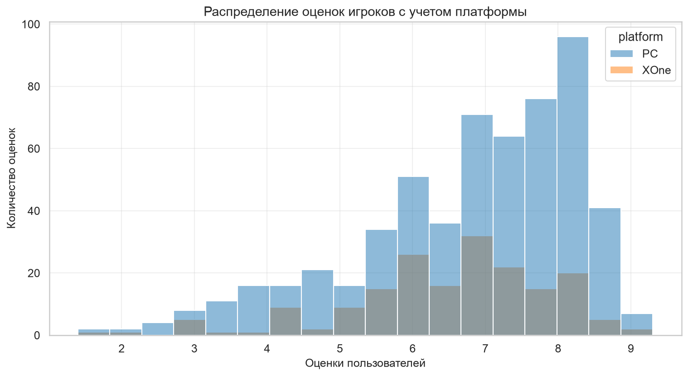

**Интерпретация:**
- p-value = 0.041 < 0.05 → **нулевая гипотеза отвергается**, средние рейтинги статистически различаются;
- знак T отрицательный, значит средний рейтинг XOne **ниже**, чем у PC;
- однако **размер эффекта очень мал** (d = 0.17 — по шкале Коэна «малый»);
- доверительный интервал `[-0.48, -0.01]` почти касается нуля — граница практической значимости не пройдена;
- мощность теста низкая (0.49) — есть риск ошибки II рода.

**Практический вывод:** разница статистически значима, но настолько мала (не более 0.5 балла из 10), что в реальной бизнес-задаче ей можно пренебречь. На потребительские предпочтения и продажи она влиять не будет.

### 5.2. Гипотеза о различии средних пользовательских рейтингов жанров Action и Sports

**Формулировка:**
- **H0:** средние пользовательские рейтинги жанров Action и Sports одинаковые;
- **H1:** средние пользовательские рейтинги жанров Action и Sports различаются.

**Метод:** t-тест Уэлча.

**Результат:** 

| T | dof | p-value | CI95 | Cohen's d | Мощность |
|---|---|---|---|---|---|
| 7.645 | 855.4 | **>0.001** | [0.48, 0.8] | 0.44 | 1 |

**Интерпретация:**
- p-value = < 0.05 → **нулевая гипотеза отвергается**, средние рейтинги статистически различаются;
- знак T положительный, значит средний рейтинг Actions **выше**, чем у Sports;
- Размер эффекта средний (d = 0.44)
- Мощность теста максимальна (1.0)
- Результат можно считать надёжным и практически значимым.

**Практический вывод:** Пользовательские рейтинги Action и Sports значимо и ощутимо различаются. T-тест Уэлча показал высокую статистическую значимость (p < 0.001) и средний размер эффекта (Cohen's d = 0.44) при максимальной мощности теста (1.0). Игроки ставят жанру Action заметно более высокие оценки, чем жанру Sports. В отличие от первой гипотезы (XOne vs PC, d = 0.17 — малый эффект), различие по второй гипотезе является практически значимым и должно учитываться при планировании ассортимента и рекламных кампаний. 

## 6. Общие выводы и рекомендации

### 6.1. Итоговые выводы по данным

1. **Жизненный цикл платформ.** Средний срок жизни платформы — около 10 лет. Платформы PS4, XOne и WiiU в 2016 году находятся в начале жизненного цикла, а PS3, Wii, X360 — на завершающей стадии. PC — стабильная платформа с особым циклом.

2. **Оценки критиков важнее оценок пользователей.** Корреляция продаж с оценками критиков заметна и устойчива (r = 0.24 на Wii, r = 0.39 на PS4/XOne/WiiU), а с оценками пользователей — слабая или отсутствует (r = 0.14 и r = 0.03 соответственно).

3. **Самые прибыльные жанры** — Shooter, Sports, Action. Аутсайдеры — Adventure, Strategy, Puzzle.

4. **Региональные различия** — существенны: рынки NA, EU и Other схожи между собой, а Япония кардинально отличается по платформам (PSP, 3DS), жанрам (Role-Playing) и по роли рейтинга ESRB.

### 6.2. Рекомендации для кампании на 2017 год

1. **Ставка на платформы нового поколения.** Основной фокус — **PS4** и **Xbox One**. PS4 — универсальный выбор: лидирует в NA, EU и Other, входит в перспективные в JP. Для японского рынка дополнительно учесть **WiiU** и **3DS**.

2. **Ставка на жанры.** Приоритетные — **Shooter** и **Action**. В Японии — **Role-Playing**. Жанры Adventure, Strategy, Puzzle не рассматривать как основные.

3. **Работа с отзывами.** В маркетинговых материалах и при отборе игр ориентироваться на **оценки критиков** — это надёжный и статистически подтверждённый предиктор успеха. Оценки пользователей как критерий отбора использовать не стоит.

4. **Учёт ESRB.** Для NA, EU и Other учитывать возрастные рейтинги (M, E, T) — они влияют на продажи. Для Японии этот критерий неинформативен.

5. **Региональная адаптация.** Кампании для NA, EU и Other могут быть унифицированы. Для Японии необходима отдельная стратегия: другие платформы, жанры и отсутствие ориентации на ESRB.

6. **Период данных.** Для прогноза на 2017 год имеет смысл использовать данные не старше 10 лет (2007+), так как рынок быстро обновляется, а старые платформы уже не актуальны.

### 6.3. Ограничения анализа

- Данные за 2016 год неполные, поэтому при оценке трендов последних лет возможны искажения.
- Большая доля пропусков в `critic_score` и `user_score` (~50%) — корреляции и t-тесты построены только на подвыборке с оценками, что может смещать результат.
- Корреляция не означает причинно-следственную связь: высокая оценка критиков **связана** с успехом, но не обязательно **является** его причиной.
- ESRB — западная система рейтингов, поэтому её отсутствие в Японии объясняется разницей систем, а не реальным отсутствием возрастных ограничений.
- Выводы о перспективности платформ сделаны по данным до 2016 года; в реальной ситуации потребовался бы дополнительный анализ актуального рынка.